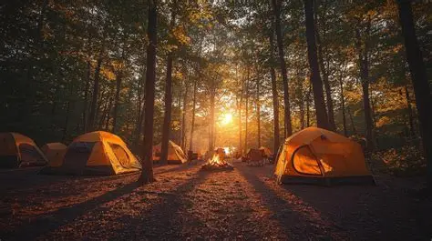

# 🏕️ CAMPING SURVIVAL GUIDE

## The Ultimate Beginner's Guide to Camping

> Adventure starts where the road ends.



---

## 📑 Table of Contents

1. [Introduction](#-introduction)
2. [Camping Equipment](#-essential-camping-equipment)
3. [Types of Camping](#-types-of-camping)
4. [Camping Checklist](#-camping-checklist)

---

## 🌲 Introduction

[Camping](https://en.wikipedia.org/wiki/Camping) is a great way to escape everyday routines and explore nature.

**The main goals of this guide are:**

- Learn what equipment you need.
- Discover different types of camping.
- Prepare for unexpected situations.

### Why should you try camping?

Camping offers many benefits:

- Spending time outdoors.
- Discovering new places.
- Improving independence.

*Camping is not just about sleeping in a tent.*

```python
def calculate_water(people, days):
    water_per_day = 3
    total_water = people * days * water_per_day
    return total_water

print(calculate_water(2, 3))
---
